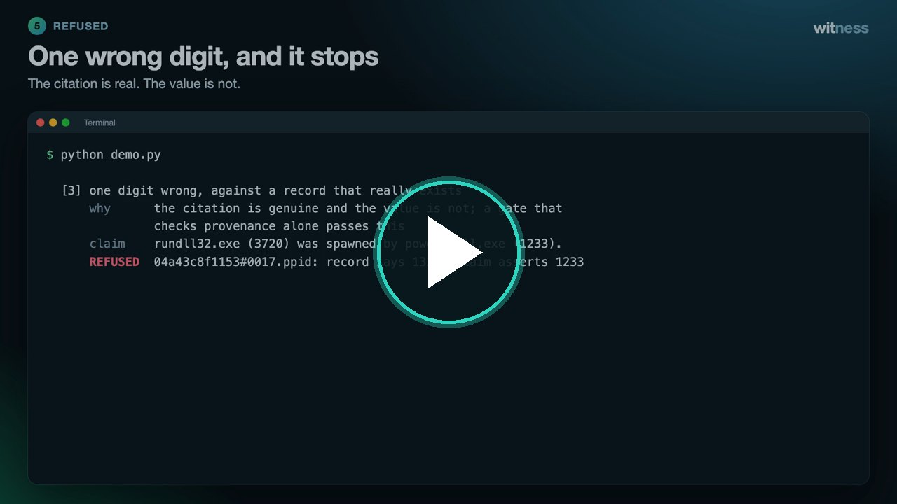

# witness

**A DFIR agent that can only report what it can prove a tool said.**

[](https://github.com/vinayvobbili/witness/actions/workflows/ci.yml)
[](https://pypi.org/project/witness-cli/)
[](https://pypi.org/project/witness-cli/)
[](https://github.com/vinayvobbili/witness/blob/main/LICENSE)

<p align="center">
  <a href="https://vinayvobbili.github.io/witness/#demo" title="Watch the 1¾-minute demo">
    
  </a>
  <br><sub>Watch the 1¾-minute demo (with sound)</sub>
</p>

## What this shows

- **The problem:** forensics agents do not fail by missing evil, they fail by inventing it: a transposed octet, a benign LOLBin called malware.
- **The idea:** a claim is admitted only if a deterministic check confirms the cited tool output says it. No second model to argue with.
- **The result:** on captured Volatility output, 7 claims: 2 admitted, 5 refused, each with the exact reason.

## Quick start

```bash
pip install witness-cli                  # the library and the `witness` command
git clone https://github.com/vinayvobbili/witness && cd witness
python demo.py                           # or `witness demo`; the captured evidence is in the clone
```

No API key, no memory image, no network, nothing outside the standard library.

## Read more

- [Using witness](docs/usage.md): run it, install it, drive it by hand, the tests
- [How it works](docs/how-it-works.md): the gate, the second gate, decoding, the report
- [Decisions and what failed](docs/decisions.md): what was tried against it and what accuracy costs
- [Design and status](docs/design.md): scope, evidence integrity, what is built
- [Accuracy](docs/ACCURACY.md) and the [demo shot list](docs/DEMO.md)

MIT licensed.
